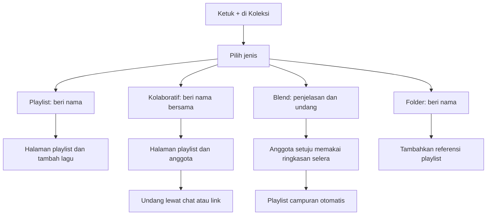

# Riset dan audit Playlist, Kolaboratif, Blend, dan Folder untuk Gratify

Tanggal: 12 Oktober 2026. Status: riset dan rancangan, belum implementasi fitur baru.

Keempat konsep dapat diterapkan di Gratify. Playlist biasa sudah mempunyai fondasi yang sesuai. Folder membutuhkan penyimpanan organisasi koleksi. Kolaboratif membutuhkan anggota, undangan, dan perubahan sinkronisasi. Blend membutuhkan mesin penggabungan selera musik selain mekanisme undangan.

Audit ini menggunakan delapan screenshot pengguna, dokumentasi resmi Spotify/Android/Supabase, pemeriksaan kode, metadata database produksi secara baca saja, dan dua permintaan HTTP publik. Tidak ada akun, playlist, pesan, atau konfigurasi server yang diubah. Tidak ada APK yang dibangun atau dipasang. Perbaikan foto, loading, dan privasi yang sebelumnya disiapkan tetap terpisah dari rancangan ini.

## 1. Apa yang terlihat pada referensi

| Screenshot | Temuan pada gambar |
| --- | --- |
| 095512 | Editor nama, deskripsi, sampul, privasi, dan hapus playlist. |
| 095527 | Pilihan membuat gambar sampul atau mengganti gambar. |
| 105816 | Nama playlist biasa disiapkan dan dipilih agar mudah diganti. |
| 110001 | Halaman playlist, tambah lagu, rekomendasi, dan tombol + di dekat foto pemilik. |
| 110037 | Menu + berisi Playlist, Playlist kolaboratif, Blend, dan Folder. |
| 110547 | Daftar orang, pemilik, dan Tambah kolaborator. |
| 110601 | Berbagi dengan pilihan Undang sebagai kolaborator, melalui pesan atau link. |
| 110713 | Halaman undangan Blend dengan penjelasan tentang rekomendasi dari selera bersama. |

Teks dan tombol pada screenshot menjadi referensi alur, bukan instruksi untuk mengoperasikan akun Spotify. Cara pembuatan token, pemeriksaan akses, dan algoritme internal Spotify tidak dapat disimpulkan dari gambar.

Spotify menjelaskan bahwa kolaborator dapat menambah, menghapus, dan mengurutkan lagu; link undangan berlaku tujuh hari, dan pemilik bisa mengeluarkan kolaborator melalui daftar foto anggota. [Panduan kolaboratif Spotify](https://support.spotify.com/us/article/collaborative-playlists/).

Blend Spotify menggabungkan musik berdasarkan aktivitas mendengarkan, memperbarui hasil setiap hari, dan mendukung undangan hingga sepuluh teman. Anggotanya dapat mengundang teman lain. [Panduan Blend Spotify](https://support.spotify.com/us/article/social-recommendations-in-playlists/).

Folder Spotify sekarang dapat dibuat di ponsel, desktop, dan web, termasuk folder di dalam folder serta perpindahan playlist. [Panduan folder Spotify](https://support.spotify.com/us/article/playlist-folders/).

Spotify juga memisahkan privasi playlist dari pemajangan profil, dan menyediakan akses tertentu melalui undangan. Gratify perlu mempertahankan aturan profil yang telah dipilih pengguna: pin playlist privat terlihat hanya pada profil pemilik sendiri. [Privasi dan akses Spotify](https://support.spotify.com/us/article/playlist-privacy-and-access/).

## 2. Audit Gratify saat ini

| Bagian | Bukti yang ditemukan | Implikasinya |
| --- | --- | --- |
| Pembuatan biasa | Tombol koleksi memanggil `openPlaylistBuilder()`. Setelah nama disimpan, `finishPlaylistCreation()` membuka `LocalPlaylistDestination`. | Urutan beri nama → halaman playlist sudah tersedia; menu empat pilihan dan nama otomatis belum tersedia. |
| Identitas playlist | `LocalPlaylistEntity` mempunyai `syncId`, `sourceSharedPlaylistId`, dan identitas pemilik koleksi. Database mempunyai UUID cloud serta `client_sync_id`. | Identitas stabil bisa digunakan kembali; ID lokal Room tidak boleh menjadi identitas undangan lintas perangkat. |
| Keanggotaan | Metadata produksi tidak mempunyai tabel bernama folder, collaborator, blend, invite, atau member pada schema public. Cloud playlist tidak mempunyai jenis kolaboratif atau Blend. | Keanggotaan dan undangan baru harus disimpan di server. |
| Hak edit | RLS cloud playlist/items mengizinkan perubahan hanya oleh pemilik. Playlist privat dibaca pemilik; publik dibaca publik. | Menambah ikon atau mengirim link saja belum memberi hak edit. Jangan membuka hak edit untuk seluruh pengguna. |
| Sinkronisasi | `SocialRepositoryImpl.syncUpPlaylist()` mengirim seluruh daftar. RPC produksi `gratify_replace_cloud_playlist_v2` menghapus semua item lalu mengisi ulang. v3 memakai v2. | Cocok sebagai penggantian snapshot milik satu pemilik. Jika pola ini diperluas kepada beberapa editor tanpa revisi, snapshot lama dapat menghapus perubahan editor lain. Ini risiko rancangan kolaboratif, bukan bukti pengguna lain sekarang bisa mengedit. |
| Simpan playlist orang lain | Playlist tersimpan punya `sourceSharedPlaylistId`; implementasi mencegah publikasi ulang sebagai playlist milik sendiri. | Simpan/follow harus tetap berbeda dari menjadi editor. Kolaboratif harus menunjuk playlist kanonis yang sama. |
| Chat | Pesan menyimpan `body`, bukan jenis kartu undangan. UI memakai `Text(message.body)` tanpa tombol link khusus. | Teks link dapat dikirim, tetapi kartu undangan yang dapat ditekan membutuhkan pekerjaan baru. |
| Pembaruan chat | `FriendsSocialViewModel.start()` memeriksa inbox/percakapan setiap lima detik; lifecycle layar menghentikannya. | Infrastruktur pesan bisa digunakan. Sinkronisasi playlist kolaboratif tetap membutuhkan jalur perubahan tersendiri. |
| Statistik | `user_play_history` menyimpan lagu, `listen_count`, dan `played_at`, dengan akses hanya pemilik. Analytics lokal mempunyai event timestamp dan detik didengarkan. | Ada bahan awal Blend; belum ada ringkasan selera bersama dan persetujuan berbagi. Riwayat mentah tidak perlu dibuka kepada anggota. |
| Arti jumlah dengar | `totalPlayTime` dinaikkan +1 oleh DAO dan disalin ke `listen_count`. | Ini jumlah dengar pada jalur tersebut, bukan durasi. Durasi dengar untuk Blend harus menggunakan analytics yang sesuai. |
| Waktu riwayat cloud | `played_at` berasal dari `song.inLibrary`, bukan langsung timestamp event analytics. | Pembobotan selera terkini perlu memastikan kapan timestamp ini diperbarui; belum dapat dianggap sebagai rangkaian event dengar yang lengkap. |
| Link aplikasi | Manifest menerima `https://gratify.org/app/`. Router mendukung profil, media, dan playlist YouTube; belum ada route penerimaan undangan. | Route baru diperlukan. `/app/playlist?list=...` saat ini diperlakukan sebagai playlist YouTube, sehingga tidak cocok untuk token undangan cloud. |
| Domain | GET `/.well-known/assetlinks.json` menghasilkan HTTP 200 `text/html`; parsing JSON gagal. | Pada pemeriksaan ini, asosiasi domain untuk aplikasi baru belum bisa diverifikasi. |

Bukti kode utama:

- [Navigasi playlist](D:/Tan/Gratify/composeApp/src/commonMain/kotlin/com/tan/gratify/ui/navigation/MainNavigation.kt:61), [pembuatan](D:/Tan/Gratify/composeApp/src/commonMain/kotlin/com/tan/gratify/ui/screen/library/AddSongsToPlaylistScreen.kt:58), [tombol koleksi](D:/Tan/Gratify/composeApp/src/commonMain/kotlin/com/tan/gratify/ui/screen/library/LibraryScreen.kt:378).
- [Snapshot sinkronisasi](D:/Tan/Gratify/core/data/src/commonMain/kotlin/com/tan/data/repository/SocialRepositoryImpl.kt:83), [entitas lokal](D:/Tan/Gratify/core/domain/src/commonMain/kotlin/com/tan/domain/data/entities/LocalPlaylistEntity.kt:13).
- [Model pesan](D:/Tan/Gratify/core/domain/src/commonMain/kotlin/com/tan/domain/data/model/social/FriendsSocialModels.kt:49), [tampilan pesan](D:/Tan/Gratify/composeApp/src/commonMain/kotlin/com/tan/gratify/ui/screen/friends/FriendsChatContent.kt:99), [pembaruan pesan](D:/Tan/Gratify/composeApp/src/commonMain/kotlin/com/tan/gratify/viewModel/FriendsSocialViewModel.kt:64).
- [Router link](D:/Tan/Gratify/composeApp/src/commonMain/kotlin/com/tan/gratify/ui/screen/MainScreen.kt:240), [manifest](D:/Tan/Gratify/androidApp/src/main/AndroidManifest.xml:139).
- [Riwayat cloud](D:/Tan/Gratify/core/data/src/commonMain/kotlin/com/tan/data/repository/UserDataSyncRepositoryImpl.kt:215), [event analytics lokal](D:/Tan/Gratify/core/domain/src/commonMain/kotlin/com/tan/domain/data/entities/analytics/PlaybackEventEntity.kt:9).

Metadata database diperiksa langsung; definisi server terkini menjadi acuan apabila migration historis berbeda. Tidak ada isi pesan atau riwayat musik pengguna yang dibaca.

## 3. Alur tombol + yang diusulkan

Menu bawah dengan empat pilihan dan satu kalimat penjelasan untuk setiap pilihan:

| Pilihan | Tujuan dan alur |
| --- | --- |
| Playlist | Beri nama → Buat → halaman playlist kosong dengan Tambah lagu, sampul, dan rekomendasi. Nama awal `Playlist-ku No.3`. |
| Playlist kolaboratif | Beri nama playlist bersama → Buat → halaman playlist dengan deretan anggota dan tombol Undang. Nama awal `Playlist kami No.3`. |
| Blend | Halaman penjelasan selera bersama → Buat Blend/Undang → pilih teman Gratify atau bagikan link → hasil musik setelah sedikitnya dua anggota siap. |
| Folder | Beri nama folder → halaman folder kosong dengan Tambahkan playlist dan Buat playlist di sini. |

Nama awal dapat langsung diganti; nomor berasal dari penghitung yang disimpan per akun, bukan menghitung seluruh playlist publik atau memakai ID Room. Satu penghitung untuk playlist buatan sendiri dapat mempertahankan contoh nomor 3 pada kedua mode; nomor bukan identitas data. Penghapusan playlist tidak menyebabkan nomor lama dipakai ulang. Pembuatan biasa dapat bekerja offline; membuat undangan dan menerima anggota membutuhkan koneksi.

Loading pembuatan, kegagalan, retry, dan konfirmasi hasil perlu ada. Ketukan berulang tidak boleh membuat playlist atau undangan ganda. Layar yang belum tersedia tidak perlu ditampilkan sebagai tombol aktif dengan alur buntu.

## 4. Kolaboratif: undangan, anggota, dan hak edit

Tombol + di samping foto anggota membuka panel Orang: pemilik, editor, Tambah kolaborator, serta Keluar untuk anggota. Pemilik dapat mengeluarkan anggota dan mencabut/membuat ulang undangan. Bentuk ini sesuai panel pada screenshot; fungsi rincinya untuk Gratify adalah usulan.

Sediakan dua tindakan berbagi yang jelas: **Bagikan playlist** untuk mendengarkan dan **Undang kolaborator** untuk memberi hak edit. Default undangan dibuat pemilik, berlaku tujuh hari, dapat dicabut, dan mempunyai batas pemakaian. Undangan melalui chat dapat ditujukan kepada satu akun; link yang dibagikan ke luar dapat menjadi undangan beberapa pemegang link. Bedakan kedua cakupan pada UI.

Penerima bisa masuk sebagai kolaborator melalui link. Alur yang disarankan: link → aplikasi atau halaman web → login jika belum → nama playlist/pengundang dan hak yang akan didapat → Gabung → playlist masuk koleksi sebagai anggota. Setelah pengguna menekan Gabung, tidak perlu persetujuan manual kedua dari pemilik untuk undangan valid yang memang dibuatnya.

Jangan menambah anggota hanya karena URL dibuka: preview WhatsApp, pemindai link, dan GET browser tidak boleh mengubah keanggotaan. Bila aplikasi belum terpasang, halaman web menawarkan pemasangan dan meminta penerima membuka kembali link atau memasukkan kode setelah login. Kelanjutan undangan lintas pemasangan perlu dibuat dan diuji; belum tersedia otomatis pada aplikasi saat ini.

Usulan URL menggunakan path khusus di domain milik Gratify, misalnya `/app/invite/<token-acak>`. Ini rancangan route, bukan link yang sekarang berfungsi. Token menyimpan kemampuan menerima undangan, bukan token login. Server menyimpan hash token, masa berlaku, pencabutan, role, target akun bila ada, batas penggunaan, dan pencatatannya. Penerimaan dilakukan sebagai transaksi akun terautentikasi, dengan batas laju dan hasil idempoten agar retry tidak menggandakan anggota. Token tidak ditulis ke log, analytics, atau metadata preview. Preview undangan privat tidak membocorkan daftar lagu.

| Tindakan | Pemilik | Editor | Pendengar publik |
| --- | --- | --- | --- |
| Mendengar | Ya | Ya, selama menjadi anggota | Hanya bila publik |
| Tambah/hapus/urut lagu | Ya | Ya | Tidak |
| Ubah nama, sampul, privasi | Ya | Tidak pada versi awal | Tidak |
| Undang/cabut anggota | Ya | Tidak pada versi awal | Tidak |
| Hapus playlist untuk semua | Ya | Tidak | Tidak |
| Keluar dari kolaborasi | Mengelola/hapus playlist | Ya | Tidak berlaku |

Privasi dan kolaborasi menjadi dua pengaturan berbeda. Privat kolaboratif berarti **pemilik dan anggota yang diundang** dapat mengakses; Search dan profil pengunjung tetap tidak menampilkannya. Pin privat pada profil hanya terlihat oleh pemilik sendiri, termasuk saat pengunjung merupakan anggota; anggota menemukannya melalui koleksi atau undangan. Mengubah publik menjadi privat tidak otomatis mengeluarkan editor. Sediakan tindakan terpisah **Batasi hanya saya** untuk mencabut anggota serta seluruh undangan.

Playlist kanonis tetap dimiliki satu akun. Anggota tidak memperoleh salinan milik sendiri ketika bergabung. Bila pemilik menghapus playlist, semua akses anggota berakhir; menghapusnya dari koleksi anggota berarti keluar, bukan menghapus playlist untuk semua. Transfer kepemilikan dapat ditambahkan kemudian.

## 5. Perubahan data dan sinkronisasi yang diperlukan

Rancangan awal, belum migration:

| Data | Isi dan batasan |
| --- | --- |
| Playlist | Jenis personal/collaborative/blend, UUID kanonis, pemilik, revisi, nama/deskripsi/sampul, privasi. |
| `playlist_members` | Playlist, user, peran, waktu bergabung, status; unik playlist+user. |
| `playlist_invites` | Hash token, pengundang, jenis/role, target opsional, kedaluwarsa, pencabutan, batas penggunaan. |
| Item/operasi playlist | ID item stabil, lagu, urutan, added_by; operation_id untuk retry; revisi transaksi. |
| Keanggotaan Blend | Persetujuan, status kesiapan, ringkasan selera dan versi generator; hanya server/anggota berwenang. |
| Folder dan item koleksi | Pemilik folder, ID stabil, revisi serta referensi playlist lintas tipe. |

Pengeditan kolaboratif harus menggunakan operasi tambah/hapus/pindah berdasarkan ID item. Pengurutan memakai pemeriksaan revisi; konflik menampilkan data terbaru dan menawarkan retry, bukan mengganti semua lagu secara diam-diam. Perubahan serentak diproses atomik pada server. Aplikasi menampilkan tersimpan hanya setelah respons server; offline, jika didukung, menampilkan menunggu sinkronisasi.

RPC snapshot lama harus menolak penggantian daftar untuk playlist kolaboratif/Blend. Ini juga melindungi perubahan anggota dari perangkat pemilik yang masih memakai APK lama. Fitur baru perlu guard server sebelum UI diaktifkan; klien lama tidak cukup dilindungi oleh perubahan UI saja.

RLS perlu menambahkan pembacaan anggota untuk playlist privat dan operasi edit yang sesuai role. Search publik tetap memfilter `is_public=true` dan tidak mencampur daftar anggota ke penemuan publik. Pencabutan keanggotaan diperiksa pada setiap operasi server. Cache anggota dibatasi per akun dan dibersihkan pada perubahan akun/keluar/revokasi yang diketahui; data yang sudah diunduh tidak dapat ditarik kembali dari perangkat lain secara mutlak.

Perubahan dapat dikirim lewat Realtime atau revalidasi terarah. Realtime bukan pengganti transaksi atau pengecekan revisi. Supabase menjelaskan pengiriman perubahan Postgres kepada klien; otorisasi dan biaya pemrosesan perlu diperhitungkan. [Dokumentasi Realtime](https://supabase.com/docs/guides/realtime/postgres-changes).

## 6. Chat sebagai saluran undangan

Chat Gratify cocok untuk mengirim undangan kolaboratif maupun Blend. Spotify sendiri mempunyai fitur pesan untuk berbagi konten. [Spotify Messages](https://support.spotify.com/us/article/messages/).

Tambahkan kartu pesan dengan jenis `playlist_invite` atau `blend_invite`, metadata versi, invitation_id, judul/foto yang diizinkan, serta tombol Gabung/Lihat. Server membuat dan memvalidasi kartu; teks buatan pengguna tidak boleh menyamar sebagai undangan resmi. Saat ditekan, status terbaru diminta ke server: aktif, kedaluwarsa, dicabut, sudah bergabung, atau salah akun.

Tetap sediakan salin link dan share sheet Android. Undangan tidak perlu menunggu fitur grup chat; percakapan satu lawan satu cukup untuk versi awal. Batas chat saat ini tetap dipertahankan: percakapan yang belum diterima hanya mengizinkan pesan permintaan awal. Menerima pesan tidak berarti menerima keanggotaan playlist, dan sebaliknya. Pembuatan undangan sukses tetapi pengiriman pesan gagal ditampilkan sebagai dua hasil berbeda, sehingga retry pesan tidak membuat token baru berulang kali.

## 7. Blend Gratify yang realistis

Versi awal yang diusulkan: 2–10 anggota **termasuk pembuat**. Ini batas produk Gratify untuk mengendalikan kompleksitas; dokumentasi Spotify menggunakan istilah hingga sepuluh teman. Default privat untuk anggota. Sebelum Gabung, jelaskan bahwa nama/foto anggota dan lagu hasil pilihan selera bersama terlihat kepada anggota, serta ringkasan selera digunakan untuk menghasilkan playlist. Riwayat mentah dan pesan pribadi tidak dibagikan. Tidak perlu membaca isi chat untuk menebak selera.

Generator awal dapat bekerja tanpa AI: ambil kandidat dari lagu disukai dan ringkasan dengar yang pengguna setujui, beri bobot dengar yang valid dan kebaruan, gabungkan video ID, beri kuota seimbang per anggota, dan batasi pengulangan artis. Contoh hasil awal 30–50 lagu, berisi favorit bersama dan pilihan yang mewakili masing-masing anggota. Lagu dengan judul sama tetapi video berbeda tidak otomatis dianggap identik; normalisasi versi/live/remix memerlukan aturan tambahan.

Ringkasan selera per akun diproduksi dari analytics yang benar dan jumlah dengar terverifikasi. RLS riwayat sekarang tetap privat. Penggabungan lintas anggota dilakukan oleh fungsi server terbatas yang hanya memakai ringkasan berizin; service-role tidak dikirim dalam APK. Pengguna baru dapat memilih beberapa artis/lagu dahulu. Bila bahan belum cukup, tampilkan status menunggu selera anggota, bukan memuat tanpa batas atau mengisi dengan lagu acak tanpa penjelasan.

Hasil disimpan di server agar sama bagi semua anggota. Pembaruan harian bisa menggunakan job server atau perhitungan saat dibuka dengan TTL harian dan kunci pembuatan agar tidak dihitung ganda. Satu hari memakai satu hasil tersimpan; layar menampilkan waktu pembaruan dan hasil terakhir saat gagal. Jangan menjalankan generator berat berkala di background setiap ponsel. Ketika anggota keluar, ringkasan seleranya berhenti dipakai dan hasil perlu dibuat ulang. Jika tersisa satu anggota, Blend berstatus menunggu anggota; opsi menyimpan salinan menjadi playlist biasa dapat disediakan.

Versi awal belum perlu skor kecocokan persentase atau Blend Story. Skor tersebut memerlukan definisi, kalibrasi, serta data memadai. Hasil yang diusulkan bukan algoritme Spotify dan tidak menjanjikan kualitas rekomendasi yang sama. Blend bukan sesi pemutaran serentak.

## 8. Folder Gratify

Folder adalah susunan koleksi pribadi per akun, bukan playlist baru dan bukan folder file musik di penyimpanan Android. Memindahkan playlist ke folder tidak mengubah pemilik, privasi, anggota, atau lagu. Playlist kolaboratif yang sama bisa berada dalam folder berbeda pada koleksi setiap anggota.

Versi awal: satu tingkat folder, satu item koleksi berada di satu folder atau root. Setelah folder dibuat, tawarkan tambah playlist yang sudah ada atau buat playlist di dalamnya. Menu playlist/tekan lama menyediakan Pindahkan ke folder dan Keluarkan dari folder. Folder mempunyai nama, jumlah playlist, dan gambar ringan dari maksimal empat sampul yang sudah di-cache.

**Hapus folder hanya menghapus susunannya; seluruh playlist dipindahkan ke root.** Tidak menghapus playlist atau meninggalkan kolaborasi. Perpindahan dan penghapusan dilakukan atomik, dengan Undo bila memungkinkan. Playlist sumber yang menjadi privat/tidak tersedia tidak dibocorkan lewat sampul atau judul cache folder; tampilkan tidak tersedia setelah revalidasi.

Data folder perlu tersinkron per akun dengan ID UUID, posisi, revisi/tombstone, dan referensi item koleksi. Jangan hanya menambahkan `folder_id` pada playlist milik pembuat: susunan folder anggota bukan milik pembuat playlist. Mulai dengan playlist lokal, tersimpan, kolaboratif, dan Blend yang telah menjadi item koleksi stabil; adapter YouTube harus mempunyai referensi sumber yang jelas. Subfolder dapat ditambahkan sesudah perpindahan, penghapusan, dan sinkronisasi satu tingkat stabil, dengan pencegahan siklus.

## 9. Link dan biaya perangkat

Android App Links membutuhkan `assetlinks.json` yang valid berisi package aplikasi dan sertifikat penandatangan yang cocok. Gratify baru menggunakan `com.tan.gratify.next`; publikasi melalui Play App Signing nanti harus memakai sertifikat yang sesuai di perangkat. [Asosiasi website Android](https://developer.android.com/training/app-links/configure-assetlinks).

Pada pemeriksaan HTTP ini, endpoint assetlinks mengembalikan HTML, bukan JSON. Permintaan route undangan sintetis juga HTTP 200 HTML, tetapi status itu sendiri bukan bukti route undangan berfungsi. Ponsel tidak terhubung saat pemeriksaan sehingga keadaan verifikasi domain pada perangkat belum diperiksa. Domain, fallback web, router undangan, serta kelanjutan setelah login semuanya menjadi pekerjaan implementasi. [Cara memeriksa App Links](https://developer.android.com/training/app-links/verify-applinks).

Untuk RAM/baterai, batasi halaman lagu dan avatar, gunakan cache gambar yang sudah disiapkan, dan aktifkan pembaruan hanya saat layar relevan terlihat. Lepas listener pada keluar layar/logout, jangan membuka satu koneksi untuk setiap playlist koleksi, serta jangan memuat semua riwayat anggota ke ponsel. Server menyimpan hasil Blend; ponsel membaca daftar lagu bertahap. Batas kemampuan perangkat RAM 2–4 GB belum dapat dipastikan dari audit rancangan ini.

## 10. Urutan pengerjaan dan pemeriksaan penerimaan

Urutan yang disarankan: menu + dan alur playlist biasa → folder → fondasi undangan/hak anggota dan kolaboratif → kartu undangan chat → Blend dasar. Menu boleh dirancang sejak awal, tetapi pilihan yang belum lengkap tidak diaktifkan untuk rilis. Fondasi undangan kolaboratif dapat dipakai ulang oleh Blend.

| Pemeriksaan sebelum fitur dinyatakan selesai | Hasil yang diperlukan |
| --- | --- |
| Pembuatan dan nama | Draf bertahan saat rotasi, create berulang tidak ganda, nama otomatis konsisten per akun, langsung masuk halaman playlist. |
| Link | Cold/warm start, login/daftar dahulu, APK belum terpasang, akun salah, link cacat/kedaluwarsa/dicabut, preview GET tidak menambah anggota. |
| Akses | Pendengar publik tidak bisa edit; anggota privat bisa edit; pengguna luar gagal; pemilik bisa cabut, anggota bisa keluar. |
| Privasi | Publik→privat hilang dari Search/profil pengunjung; anggota tetap mendapat akses yang dijelaskan; Batasi hanya saya menutup undangan lama. |
| Sinkronisasi | Dua akun tambah bersamaan tidak kehilangan lagu; reorder konflik jelas; retry idempoten; snapshot APK lama tidak menimpa kolaborasi. |
| Chat | Kartu valid bisa ditekan, pesan palsu bukan kartu resmi, permintaan pesan tetap berlaku, gagal kirim punya retry yang tepat. |
| Blend | Persetujuan, bahan sedikit, kontribusi seimbang, hasil konsisten lintas anggota, pembaruan tidak ganda, anggota keluar berhenti berkontribusi. |
| Folder | Move tidak menduplikasi lagu; delete mengembalikan ke root; sinkronisasi lintas perangkat dan pergantian akun tidak mencampur folder. |
| Beban | Uji listener berulang masuk/keluar, koneksi gagal, cache panjang, dan pemakaian berkelanjutan; ukur RAM/frame/baterai saat implementasi tersedia. |

Audit ini belum menjalankan skenario tersebut pada fitur baru karena fitur belum dibuat. Prioritas rilis tetap menyelesaikan perbaikan yang sudah disiapkan dan menghindari perluasan fitur dengan sinkronisasi/privasi yang belum teruji.

Bukti pemeriksaan HTTP: [link-availability.json](D:/Tan/Gratify/artifacts/spotify-feature-research-20261012/link-availability.json). Ringkasan metadata dan cakupan: [audit-evidence.json](D:/Tan/Gratify/artifacts/spotify-feature-research-20261012/audit-evidence.json).
